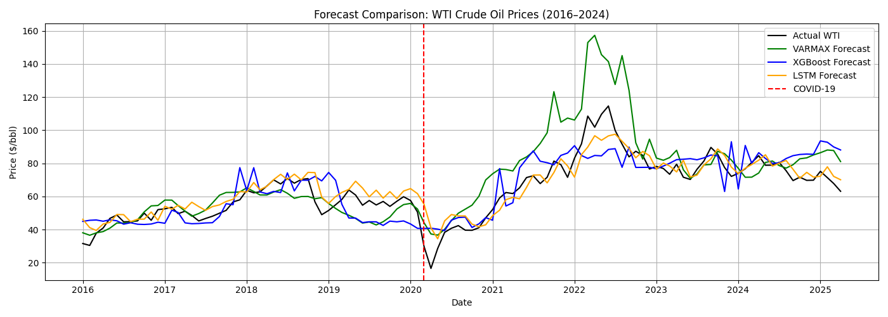
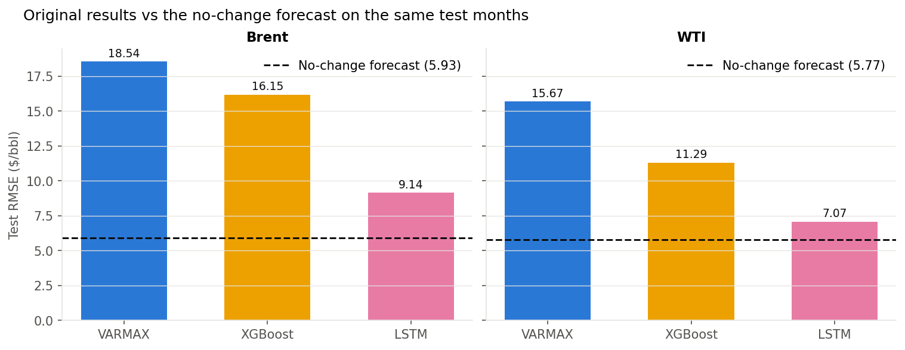
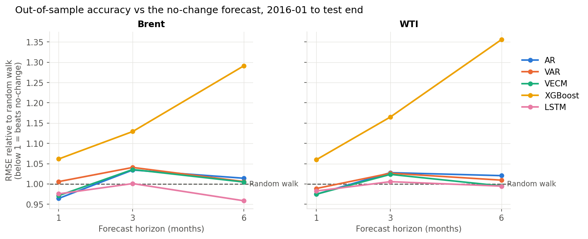
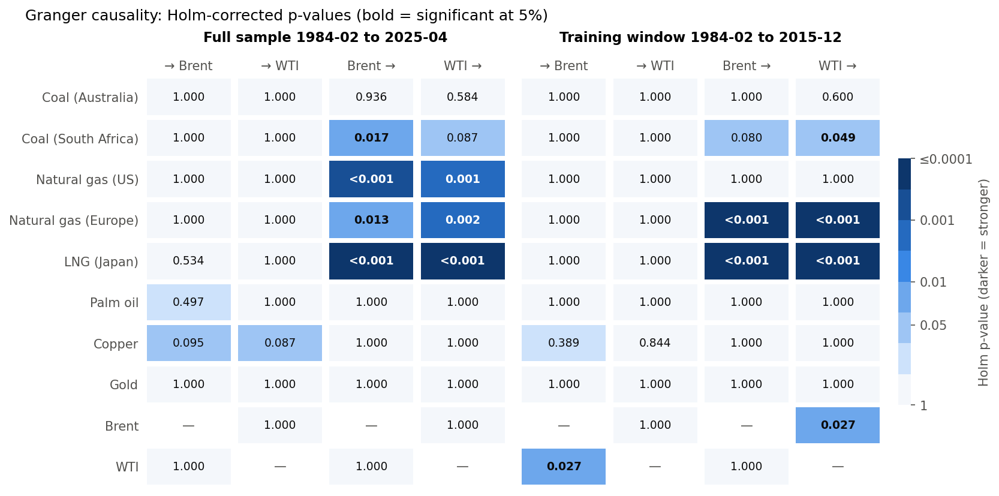

# Multivariate Time Series Forecasting of Brent and WTI Crude Oil Prices

MSc research project, *Multivariate Time Series Modeling for Comparative
Forecasting of World Oil Prices: A Case Study* (Universiti Teknologi MARA,
examined 2 August 2025), plus a follow-up re-audit of its evaluation in 2026.

## Part 1: The thesis (2025)

### Research questions

1. How can multivariate time series models be designed to improve the accuracy
   and reliability of oil price forecasting?
2. Which multivariate time series model gives the most accurate oil price forecasts?

The scope was deliberately limited to multivariate models, which account for
interactions between markets. Univariate models were excluded.

### Data

World Bank Commodity Price Data (the "Pink Sheet"), monthly. The two targets
are Brent and WTI crude oil. The eight related commodities are Australian and
South African coal, US and European natural gas, Japanese LNG, palm oil,
copper and gold. The models train to December 2015 and are tested from January
2016 to April 2025.

### Models and what each was designed to do

| Model | Role in the thesis | Setup |
|---|---|---|
| **VARMAX** | Interpretable econometric model of how Brent and WTI move together with related markets. Used as a scenario forecast: given what related markets did, where would oil be? | Brent and WTI differences modelled together, 8 related commodities as external inputs, 12 lags (chosen by AIC) |
| **XGBoost** | Tests how far related markets explain oil prices, with SHAP to show which ones matter | Last month's prices of the 8 related commodities; one model for each oil type |
| **LSTM** | Sequence model that learns from oil's own price history | 15-month windows of Brent and WTI, forecasting one month ahead; one model for each oil type |

### Thesis results (Table 4.5)

| Model | Brent RMSE | Brent MAE | Brent MAPE | WTI RMSE | WTI MAE | WTI MAPE |
|---|---|---|---|---|---|---|
| VARMAX | 18.54 | 14.04 | 20.60% | 15.67 | 11.17 | 17.72% |
| XGBoost | 16.15 | 12.45 | 18.85% | 11.29 | 8.92 | 15.46% |
| **LSTM** | **9.14** | **6.12** | **9.49%** | **7.07** | **5.31** | **10.34%** |

RMSE and MAE are in $/bbl.

**Findings as reported:**
- The LSTM was the most accurate of the three models for both Brent and WTI.
  XGBoost came second and VARMAX third.
- All three models tracked prices closely in the calm 2016-19 period and
  diverged during COVID-19 and the 2022 energy crisis. VARMAX overshot most, to
  $172 (Brent) and $157 (WTI) in April 2022.
- SHAP analysis of XGBoost: copper and European gas were the strongest
  predictors of Brent. European gas, Japanese LNG and palm oil were the
  strongest for WTI. US gas and gold had little influence on either.

Code: `code_full.py` / `code_full.ipynb` (unchanged). Outputs: `plots/`, `tables/`.
Summary report: `Report.pdf`.



---

## Part 2: The 2026 re-audit

A year later I re-ran the thesis code and re-examined how the models were
evaluated.

### What the re-audit found

- **Mostly reproducible.** VARMAX, XGBoost and every statistical test reproduce
  exactly. The LSTM had no random seed, so its score changes on every run
  (Brent RMSE 7.67 on a re-run vs 9.14 in the thesis).
- **No yardstick.** The standard benchmark in oil forecasting is the naive
  forecast, where next month's price equals this month's. On the same test
  months it scores **5.93 (Brent) and 5.77 (WTI)**, better than all three models.
- **Different questions, one leaderboard.**
  - VARMAX forecast up to 112 months ahead as a scenario, using the actual prices of related markets.
  - XGBoost explained this month's price from related markets alone.
  - The LSTM forecast one month ahead from oil's own history.

  Each design was deliberate, but ranking them on one error table mixes model
  quality with how hard each task is.



### The rebuilt evaluation (`improved/`)

Every model now answers the same question: at the end of month *t*, using only
data published by then, what will Brent and WTI cost at *t + h*? The main changes:

- a month-by-month backtest for h = 1, 3 and 6 months;
- the naive forecast and a single-series AR model as baselines;
- a VAR (all 10 commodities forecast together) and a VECM, because Brent and WTI move together over the long run;
- Diebold-Mariano significance tests;
- seeded, reproducible models;
- an automated leak test that scrambles future data and checks that no forecast moves.

### Re-audit results

Latest World Bank data: test period January 2016 to August 2026 (128 months).
Each number is the model's RMSE divided by the naive forecast's RMSE, so below
1 means better than naive.

| Model | Brent h=1 | h=3 | h=6 | WTI h=1 | h=3 | h=6 |
|---|---|---|---|---|---|---|
| AR | 0.964 | 1.034 | 1.014 | 0.975 | 1.028* | 1.021 |
| VAR | 1.006 | 1.041 | 1.006 | 0.989 | 1.027 | 1.009 |
| VECM | 0.971 | 1.036 | 1.005 | 0.975 | 1.024 | 0.995 |
| XGBoost | 1.062 | 1.129 | 1.291 | 1.060 | 1.165 | 1.356 |
| LSTM | 0.976 | 1.001 | 0.959 | 0.983 | 1.006 | 0.995 |

\* The only statistically significant difference, and it's a model doing *worse* than naive.

- **No model significantly beats the naive forecast** in any of 30 tests, at
  any horizon. This is consistent with the oil forecasting literature.
- **Related commodities add little.** The 10-commodity VAR is no better than
  the single-series AR (research question 1).
- **Shocks (research question 2):**
  - Every model beats naive during the COVID collapse and rebound.
  - The simple AR and VECM models do best there and during the 2026 price spike.
  - XGBoost does worst in 2022 and 2026.
- **Newer data doesn't change it.** The same conclusions hold on the thesis
  data (to April 2025) and after 16 more months of data.



### Do related markets lead oil? (`improved/causality.py`)

Granger causality tests, impulse responses and a variance decomposition answer
research question 1 directly:

- **No related commodity significantly leads oil** after correcting for 32
  tests. Copper comes closest (Holm p ≈ 0.09).
- **Oil leads them instead.** Oil predicts Japanese LNG 4-6 months ahead
  (consistent with oil-indexed LNG contracts), and US and European gas 1-2 months ahead.
- **Co-movement is mostly same-month.** Copper is the largest outside source
  of oil price surprises (about 5%). European gas explains almost none (0.1%),
  so its high SHAP importance in the thesis likely reflected shared price
  trends rather than predictive power.



---

## Repository layout

| Path | What it is |
|---|---|
| `code_full.py`, `code_full.ipynb` | Thesis pipeline (VARMAX, XGBoost, LSTM), unchanged |
| `Report.pdf`, `plots/`, `tables/` | Thesis summary report and its outputs |
| `CMO-Historical-Data-Monthly.xlsx` | Data used in the thesis (World Bank, to 2025-04) |
| `data/` | Newer World Bank release (to 2026-08) |
| `improved/` | Rebuilt evaluation pipeline. See [improved/README.md](improved/README.md) |
| `improved/results/` | Re-audit results on the thesis data |
| `improved/results_latest/` | Re-audit results on the latest data |
| `docs/METHODOLOGY_REVIEW.md` | Full review: reproduction, issues, results, the thesis's design intent (§8) and causality analysis (§9) |
| `docs/EXECUTION_LOG.md` | What every section of both pipelines runs, and every review run |
| `docs/REPORT_FEEDBACK.md` | Notes on the report text and references |
| `docs/VIVA_PREP.md` | Likely questions with suggested answers |

## Quick start

```bash
python3.12 -m venv .venv && source .venv/bin/activate
pip install -r requirements.txt
python code_full.py                  # thesis pipeline (~15 min; the VARMAX fit is slow)
python improved/run_all.py --quick   # re-audit smoke test (~1 min)
python improved/run_all.py           # full re-audit, thesis data
python improved/run_all.py --data data/CMO-Historical-Data-Monthly_latest.xlsx --out improved/results_latest
python improved/causality.py         # Granger causality, impulse responses, variance decomposition
python -m pytest improved/tests      # leak tests and causality checks
```
