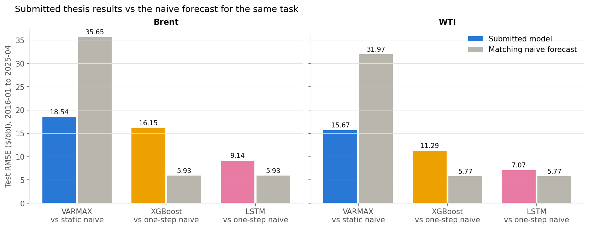
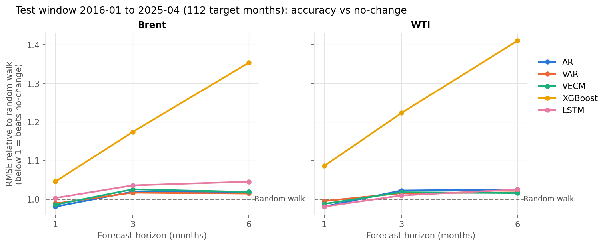

# Multivariate Time Series Forecasting of Brent and WTI Crude Oil Prices

This repository holds three pieces of work, kept separate:

| Part | What it is | Code | Evaluated on |
|---|---|---|---|
| **1. Original thesis (2025)** | MSc research project, *Multivariate Time Series Modeling for Comparative Forecasting of World Oil Prices: A Case Study* (Universiti Teknologi MARA, examined 2 August 2025). Historical work, unchanged | `code_full.py`, `code_full.ipynb` | 2016-01 to 2025-04 |
| **2. Re-audit (2026)** | A re-evaluation of the thesis's forecasting claims under a single out-of-sample protocol | `improved/` | Same test months, 2016-01 to 2025-04 |
| **3. Holdout** | The same re-audit design scored on World Bank data released after the thesis data ended | `improved/` with `--data data/…_latest.xlsx` | 2025-05 to 2026-08 |

---

## Part 1: The original thesis (2025, historical)

Nothing in this part has been changed: the code, outputs (`plots/`, `tables/`) and
`Report.pdf` are as submitted.

**Research questions.**
1. How can multivariate time series models be designed to improve the accuracy and reliability of oil price forecasting?
2. Which multivariate time series model gives the most accurate oil price forecasts?

Univariate models were excluded by the thesis's scope.

**Data.** World Bank Commodity Price Data ("Pink Sheet"), monthly average prices.
Targets: Brent and WTI. Related series: Australian and South African coal, US and
European natural gas, Japanese LNG, palm oil, copper, gold. Train to 2015-12, test
2016-01 to 2025-04.

| Model | Role in the thesis | Setup |
|---|---|---|
| **VARMAX** | Econometric scenario model: given what related markets did, where would oil be? | Brent and WTI differences, 8 related commodities as external inputs, 12 lags; one path forecast 1 to 112 months ahead from Dec 2015, using the **actual** related-market prices |
| **XGBoost** | How far related markets explain oil, with SHAP to show which matter | Last month's prices of the 8 related commodities; no oil price history; forecasts one month ahead |
| **LSTM** | Sequence model on oil's own history | 15-month windows of Brent and WTI prices; forecasts one month ahead |

**Results reported in the thesis** (Table 4.5; RMSE and MAE in $/bbl):

| Model | Brent RMSE | Brent MAE | Brent MAPE | WTI RMSE | WTI MAE | WTI MAPE |
|---|---|---|---|---|---|---|
| VARMAX | 18.54 | 14.04 | 20.60% | 15.67 | 11.17 | 17.72% |
| XGBoost | 16.15 | 12.45 | 18.85% | 11.29 | 8.92 | 15.46% |
| LSTM | 9.14 | 6.12 | 9.49% | 7.07 | 5.31 | 10.34% |

The thesis ranked the LSTM first, XGBoost second and VARMAX third. The ranking is
correct *among the three*, but the three models were given different tasks
(one-month forecasts vs a 1- to 112-month scenario path), so it mixes model quality
with task difficulty.

**Statements in the thesis text that the code does not support:**

| Thesis text says | What the code does |
|---|---|
| Economic indicators ("exchange rates, industrial production, CPI and interest rates") were incorporated (Conclusion); IMF data and the Caldara & Iacoviello geopolitical risk (GPR) index are listed as sources (`Report.pdf` §5.2) | Only the 10 World Bank commodity prices are used. No macroeconomic or geopolitical-risk data is loaded anywhere |
| The study addresses long-term forecasting and performance across economic conditions | XGBoost and the LSTM forecast one month ahead. VARMAX's long path is conditioned on actual future related-market prices, so it isn't a long-term *forecast*. Performance by regime is discussed from charts, not measured |
| The LSTM is the most accurate and robust model "across all market phases" | The LSTM is best of the three on RMSE, MAE and MAPE, but loses to a naive one-step forecast (5.93 vs 9.14 for Brent), and robustness across regimes was not tested. A re-run gives a different LSTM score (no random seed) |
| Data from 1960 (or 2010) to December 2024 | The models use 1982-01 to 2025-04 |
| In 2021-23 XGBoost overshoots to over $160 | The overshoot is VARMAX's ($172 Brent, $157 WTI in April 2022) |


---

## Part 2: The 2026 re-audit

**Why.** The thesis compared the three models without a benchmark, on different
forecasting tasks, and some of its diagnostics did not test what they claimed (see
[docs/METHODOLOGY_REVIEW.md](docs/METHODOLOGY_REVIEW.md)). The first check is the
naive forecast for each model's own task, on the same 112 months:

| RMSE ($/bbl) | Thesis model | Matching naive forecast |
|---|---|---|
| Brent: XGBoost / LSTM (one month ahead) | 16.15 / 9.14 | 5.93 (last month's price) |
| Brent: VARMAX (1 to 112 months ahead) | 18.54 | 35.65 (Dec-2015 price held flat) |
| WTI: XGBoost / LSTM | 11.29 / 7.07 | 5.77 |
| WTI: VARMAX | 15.67 | 31.97 |

The two one-month models are worse than doing nothing. VARMAX beats its naive
benchmark, but only because it was given the actual future prices of the related
commodities, which a real forecaster would not have.



**Design** (details in [improved/README.md](improved/README.md)):
- **One question for every model:** at the end of month *t*, using only data
  published by then, forecast the monthly-average Brent and WTI prices at *t + h*,
  for h = 1, 3, 6.
- **Models:** no-change (naive) and univariate AR baselines; VAR on all 10
  commodities; VECM on Brent and WTI; XGBoost; LSTM.
- **Rolling origins, expanding window, log-returns.**
- **Separate windows:** hyperparameters chosen on 2010-01 to 2015-12 (validation);
  results reported on 2016-01 to 2025-04 (test).
- **Tests against no-change:**
  - Clark-West, the right test when the benchmark is nested in the models;
  - Diebold-Mariano as a secondary check;
  - both Holm-corrected across the 30 comparisons.
- **Leakage tests** for every pipeline, horizon and several origin blocks.

**Results, test window 2016-01 to 2025-04** (RMSE ÷ naive RMSE; below 1 = better than no-change):

| Model | Brent h=1 | h=3 | h=6 | WTI h=1 | h=3 | h=6 |
|---|---|---|---|---|---|---|
| AR | 0.980 | 1.019 | 1.019 | 0.981 | 1.022 | 1.025 |
| VAR | 0.989 | 1.017 | 1.014 | 0.995 | 1.015 | 1.017 |
| VECM | 0.985 | 1.025 | 1.019 | 0.988 | 1.018 | 1.016 |
| XGBoost | 1.045 | 1.174 | 1.354 | 1.086 | 1.223 | 1.410 |
| LSTM | 1.003 | 1.036 | 1.045 | 0.981 | 1.009 | 1.025 |

Naive RMSE at h = 1: Brent 5.93, WTI 5.77.

- **No model shows significant predictive content over no-change.** None of the
  30 Clark-West tests is significant after Holm correction. The strongest raw
  result, the LSTM for WTI at h = 1 (raw p = 0.006, 60% directional accuracy),
  becomes p = 0.18 after correction.
- **Gains are small where they exist.** AR, VAR and VECM are 0.5-2% better than
  no-change at one month and 1-3% worse at three and six months.
- **XGBoost is consistently worse**, by 4-41%, even with hyperparameters chosen on
  the validation window.
- **The related commodities add little** (research question 1). The
  10-commodity VAR is no better than the single-series AR.
- **By period** (descriptive only; the windows were chosen after seeing the data):
  AR and VECM were 8-9% better than no-change in 2020-21 (COVID) and within about
  2% of it in 2016-19 and 2022-25. No test supports a claim about which model
  handles shocks best.



**Do related markets lead oil?** (`improved/causality.py`; Granger tests with
Holm correction across 34 tests per sample):
- No related commodity significantly leads oil. Copper is closest (Holm p ≈ 0.09).
- Oil significantly leads Japanese LNG (4-6 months), US and European gas (1-2
  months) and South African coal.
- In the variance decomposition, copper is the largest outside source of oil
  price surprises (about 5%). European gas explains about 0.1%.

The Granger F-tests assume constant error variance, which the data violate, so
treat these p-values as approximate.

---

## Part 3: Holdout, 2025-05 to 2026-08

These 16 months were released by the World Bank after the thesis data ended.

- **No design decision in the current pipeline uses them.** Tuning, lag selection
  and model choice use data up to 2015-12 or up to each forecast origin.
- **They are not completely unseen, though.** An earlier version of the re-audit
  (September 2026) was scored on a window that included them, before this design
  was fixed.
- They include a sharp spike: Brent went from $71 in February 2026 to $120 in April.

| Model | Brent h=1 | h=3 | h=6 | WTI h=1 | h=3 | h=6 |
|---|---|---|---|---|---|---|
| AR | 0.935 | 1.061 | 0.999 | 0.956 | 1.044 | 1.002 |
| VAR | 1.039 | 1.084 | 0.978 | 0.973 | 1.059 | 0.973 |
| VECM | 0.950 | 1.070 | 0.982 | 0.940 | 1.062 | 0.940 |
| XGBoost | 1.080 | 1.004 | 1.026 | 1.048 | 0.974 | 0.971 |
| LSTM | 0.990 | 0.974 | 0.944 | 0.985 | 0.966 | 0.963 |

Naive RMSE at h = 1: Brent 11.67, WTI 8.56.

- **No result is significant after correction** (lowest Clark-West Holm p = 0.88).
  Sixteen months are too few to separate models that differ by a few percent.
- **The pattern is consistent with the test window.** Nothing reliably and
  significantly beats no-change.

---

## Limitations

- **Monthly averages.** The World Bank series are monthly averages, not
  end-of-month prices. Averaging makes month-to-month changes look slightly
  predictable and can create spurious lead-lag relations. Neither effect has been
  measured here.
- **Test power.** 112 test months (16 in the holdout), and both 3- and 6-month
  forecasts overlap. Differences of a few percent in RMSE cannot be told apart
  from noise.
- **Test-set reuse.** The 2016-2025 test months were examined repeatedly: by the
  thesis, then by the re-audit. The holdout was seen once under an earlier design.
  No window here is a clean, never-seen holdout.
- **Limited tuning.** Small, pre-specified grids for XGBoost (6 candidates) and the
  LSTM (4 candidates). The chosen LSTM setting for h = 1 changed between the two
  data vintages, which differ only by rounding. So these choices are not stable.
- **Different refit schedules.** The statistical models are re-estimated every
  month; XGBoost and the LSTM are re-trained each January. The ML models see new
  data less often.
- **VECM specification.** An unrestricted constant was chosen because it's the
  case statsmodels' Johansen test covers. The average drift over 1984-2015 is near
  zero, which would favour a restricted constant. Both cases give rank 1 here.
- **Granger tests** assume homoskedastic errors, but the residuals show strong
  ARCH effects, so those p-values are approximate.
- **Scope.**
  - Only commodity prices are used as predictors. No macroeconomic, inventory,
    futures or geopolitical data.
  - Point forecasts only; no prediction intervals.
  - Horizons of at most 6 months.
- **Period breakdowns are descriptive.** The windows were chosen after seeing the
  data, and the 2026 window has 8 months.
- **Platform.** Results were produced on macOS arm64 (CPU) with the pinned
  versions in `requirements.txt`. The LSTM is seeded and deterministic on this
  platform. Bit-identical results on other platforms or GPUs are not guaranteed.

---

## Repository layout

| Path | What it is |
|---|---|
| `code_full.py`, `code_full.ipynb` | **Part 1**: thesis pipeline (VARMAX, XGBoost, LSTM), unchanged. The notebook's saved outputs come from an earlier run |
| `Report.pdf`, `plots/`, `tables/` | Part 1: thesis summary report and outputs. The full thesis (.docx) is not in this repository |
| `Crude Oil Price Forecasting.md`, `How_to_Run_Code.{md,pdf}` | Part 1: original project manual and run guide (historical; the manual has placeholders) |
| `CMO-Historical-Data-Monthly.xlsx` | World Bank data used by the thesis (to 2025-04) |
| `data/CMO-Historical-Data-Monthly_latest.xlsx` | World Bank release of 2 Sep 2026 (to 2026-08), for Part 3 |
| `improved/` | **Parts 2 and 3**: re-audit pipeline. See [improved/README.md](improved/README.md) |
| `improved/results/` | Part 2 outputs (thesis data) |
| `improved/results_latest/` | Part 3 holdout (`scores_holdout.csv`), plus the test window re-scored on the newer data vintage |
| `docs/METHODOLOGY_REVIEW.md` | Review of the thesis code, re-audit results, thesis design intent, causality, and the list of revisions (§10) |
| `docs/EXECUTION_LOG.md` | What every section of both pipelines runs, and every review run |
| `docs/REPORT_FEEDBACK.md` | Notes on `Report.pdf` |
| `docs/VIVA_PREP.md` | Archived question list |

## Quick start

```bash
python3.12 -m venv .venv && source .venv/bin/activate
pip install -r requirements.txt
python code_full.py                  # Part 1, thesis pipeline (~15 min; set MPLBACKEND=Agg to run headless)
python improved/run_all.py           # Part 2, re-audit on the thesis data (~15 min)
python improved/run_all.py --data data/CMO-Historical-Data-Monthly_latest.xlsx --out improved/results_latest   # Part 3
python improved/causality.py         # Granger causality, impulse responses, variance decomposition
python -m pytest improved/tests      # leakage tests and known-answer checks (~5 min)
```
