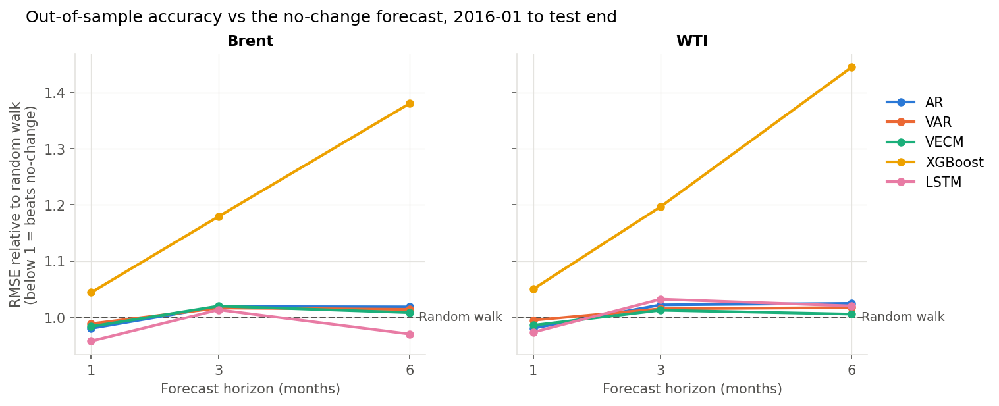

# Multivariate Time Series Forecasting of Brent and WTI Crude Oil Prices

MSc research project comparing econometric, gradient-boosting and deep-learning
models for forecasting monthly Brent and WTI prices. The data is the World Bank
Pink Sheet (`CMO-Historical-Data-Monthly.xlsx`), and the related commodities
are coal, natural gas, LNG, palm oil, copper and gold.

## Repository layout

| Path | What it is |
|---|---|
| `code_full.py`, `code_full.ipynb` | **Original submission** pipeline (VARMAX, XGBoost, LSTM), unchanged |
| `Report.pdf`, `plots/`, `tables/` | Original report and its outputs |
| `improved/` | **Rebuilt pipeline**: one out-of-sample protocol, benchmarks, significance tests, leakage tests. See [improved/README.md](improved/README.md) |
| `improved/results/` | Tables and figures from the improved pipeline |
| `docs/METHODOLOGY_REVIEW.md` | Examiner-style review of the original code, with reproduction results |
| `docs/REPORT_FEEDBACK.md` | Section-by-section report corrections, including reference checks |
| `docs/VIVA_PREP.md` | Likely viva questions with suggested answers |

## Headline finding

In the original comparison the LSTM came out best (Brent RMSE 9.14). But a
naive **no-change forecast scores 5.93 on the same test months**, beating all
three original models. The models had also been given different forecasting
tasks.

Under a single strictly out-of-sample protocol (2016-01 to 2025-04; horizons
of 1, 3 and 6 months), **no model significantly beats the no-change forecast**.
That is consistent with the oil forecasting literature. Details and tables:
[docs/METHODOLOGY_REVIEW.md §6](docs/METHODOLOGY_REVIEW.md#6-results-of-the-improved-pipeline).



## Quick start

```bash
python3.12 -m venv .venv && source .venv/bin/activate
pip install -r requirements.txt
python improved/run_all.py --quick   # ~1 min smoke test
python improved/run_all.py           # full run, ~15-25 min on CPU
python -m pytest improved/tests      # look-ahead bias tests
python code_full.py                  # original pipeline (~15 min; VARMAX(12) is slow)
```
